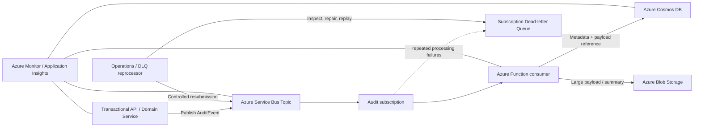

# Azure Distributed Audit Logging

## 1. Overview

This design moves audit-log processing out of the main transactional request path. The application publishes an audit event to Azure Service Bus, and an Azure Function processes the event asynchronously. Structured audit metadata is stored in Azure Cosmos DB; larger audit payloads or summaries are stored in Azure Blob Storage, with a reference and integrity metadata recorded in Cosmos DB.

The objective is to keep business requests responsive while creating a durable, searchable audit trail that can scale independently and tolerate transient downstream failures.

**Design status:** Reference architecture. The diagram describes the intended flow; implementation details and service settings must be validated for the target workload.

## 2. Goals and non-goals

### Goals
- Decouple audit persistence from business request processing.
- Preserve a durable event between publication and processing.
- Support multiple tenants without creating a separate Cosmos DB account or database per tenant.
- Handle duplicate delivery safely.
- Keep large payloads out of Cosmos DB documents when appropriate.
- Retry transient failures and isolate poison messages in a dead-letter queue (DLQ).
- Provide traceability, monitoring, retention, and an operational replay process.

### Non-goals
- Treat the audit pipeline as a substitute for transactional business data.
- Assume exactly-once delivery across Service Bus, Functions, Cosmos DB, and Blob Storage.
- Store secrets, access tokens, payment-card data, or unnecessary personal data in audit events.

## 3. High-level architecture



The transactional API publishes to Service Bus; the Function handles persistence. Blob Storage is used only when the event payload or summary is too large or is better suited to object storage. For small events, Cosmos DB can contain the full payload.

## 4. Event contract

Use a versioned, stable envelope. Example:

```json
{
  "eventId": "01JEXAMPLE8J6D4Q9M2K7X3ABC",
  "eventType": "Policy.Updated",
  "schemaVersion": 1,
  "occurredAtUtc": "2026-10-29T12:00:00Z",
  "tenantId": "tenant-123",
  "actor": {
    "subjectId": "user-456",
    "displayName": "Example user"
  },
  "resource": {
    "type": "Policy",
    "id": "policy-789"
  },
  "correlationId": "request-or-workflow-id",
  "traceparent": "W3C trace context, when available",
  "summary": {
    "changedFields": ["status"]
  },
  "payload": {
    "status": "Active"
  }
}
```

This is illustrative. Prefer allow-listed audit fields over serialising whole domain objects or HTTP requests. Omit credentials, tokens, payment-card data, and unnecessary personal information.

### Identity fields
- **eventId:** stable identifier generated by the producer, reused on retries and replays of the same logical event.
- **tenantId:** tenant boundary; validate it from trusted application context, not an arbitrary client-supplied field.
- **occurredAtUtc:** when the business action occurred, not when the consumer processed it.
- **correlationId / traceparent:** connect the event to the originating request and downstream processing.
- **schemaVersion:** enables controlled evolution of the event contract.

## 5. End-to-end flow

1. A business operation completes or reaches the point at which an audit record must be emitted.
2. The application creates an `AuditEvent` with a stable `eventId`, tenant identity, actor, resource, timestamp, and allow-listed details.
3. The producer sends the event to a Service Bus Topic. If several independent consumers need the event, each can have its own subscription. If only one audit consumer is required, a Queue may be simpler; a Topic is useful when fan-out is a requirement.
4. The audit subscription delivers the message to an Azure Function.
5. The Function validates the schema, tenant ID, required fields, and payload size. It computes a content hash for large payloads if integrity verification is required.
6. For a large payload, the Function writes a blob using a deterministic path derived from tenant and event IDs (or another collision-safe key), then writes the Cosmos DB audit document containing the blob reference. For a small payload, it stores the payload directly in Cosmos DB.
7. The Function completes the Service Bus message only after required durable writes have succeeded.
8. On transient failure, processing is retried according to the configured retry and Service Bus delivery policy. After the configured maximum delivery count, Service Bus moves the message to the subscription DLQ.
9. Operators inspect the DLQ, identify the cause, correct the issue, and replay only after validation.

## 6. Persistence model

### Cosmos DB audit document

Example for a large payload:

```json
{
  "id": "01JEXAMPLE8J6D4Q9M2K7X3ABC",
  "tenantId": "tenant-123",
  "eventType": "Policy.Updated",
  "schemaVersion": 1,
  "occurredAtUtc": "2026-10-29T12:00:00Z",
  "processedAtUtc": "2026-10-29T12:00:02Z",
  "actorId": "user-456",
  "resourceType": "Policy",
  "resourceId": "policy-789",
  "correlationId": "request-or-workflow-id",
  "payloadStorage": "blob",
  "payloadBlobName": "tenant-123/2026/10/01JEXAMPLE8J6D4Q9M2K7X3ABC.json",
  "payloadSha256": "illustrative-hash-value"
}
```

### Tenant isolation and partitioning

For a shared container, a candidate partition key is `/tenantId`, which groups a tenant's audit documents and supports tenant-scoped queries. This choice must be validated against tenant size, throughput, and hot-partition risk. A very large tenant may require a more granular key such as a tenant-plus-time bucket, with corresponding query implications.

Use application-level tenant authorization on every read. A partition key is a data distribution and query design choice, not an authorization boundary by itself. Restrict access with managed identities and least-privilege data-plane permissions.

### Blob storage

- Use private containers; disable anonymous public access.
- Use managed identity and least-privilege Blob data roles.
- Use deterministic, collision-safe blob names so retries do not create uncontrolled duplicates.
- Store the blob URI/name, content type, size, and optional hash in Cosmos DB.
- Apply lifecycle and retention policies aligned with audit and legal requirements.
- Consider encryption, immutability/WORM controls, soft delete, versioning, and legal hold where required by the threat model and compliance needs.
- Avoid placing sensitive identifiers in blob names where they may appear in logs.

### Ordering of blob and Cosmos writes

Blob Storage and Cosmos DB do not share a distributed transaction. If the Function writes the blob and then fails before writing Cosmos DB, an orphan blob can remain. If it writes Cosmos first and the blob write fails, the audit record may point to a missing object.

Recommended approach:
1. Write the blob idempotently first.
2. Write the Cosmos document with the same stable event ID and blob reference.
3. Complete the message only after both writes succeed.
4. Run a periodic orphan-blob reconciliation / cleanup process, with a safety window and retention safeguards.
5. For reads, handle temporarily missing references safely and alert on integrity failures.

For strict audit completeness, define which write is the authoritative commit and how reconciliation repairs partial outcomes.

## 7. Idempotency and duplicate delivery

Azure Service Bus and event consumers should be designed for at-least-once processing. Duplicate delivery can occur, including after a successful database write if the Function crashes before completing the message.

Use `eventId` as the idempotency key:
- The producer generates it once for a logical audit event and reuses it if sending is retried.
- Use the event ID as the Cosmos DB document `id`, with the tenant partition key. A create operation protected by the unique `(partition key, id)` identity prevents a duplicate document for the same tenant/event.
- If a create returns a conflict, treat it as already processed only after confirming the existing record corresponds to the same event. A mismatched event ID reused with different content should be treated as a data-integrity error.
- Use deterministic blob names or conditional writes so duplicate processing does not create multiple objects.
- Do not rely only on an in-memory cache; it is lost on restart and does not coordinate concurrent instances.
- Consider Service Bus duplicate detection as an additional producer-side safeguard where appropriate, but do not treat it as a replacement for consumer idempotency.

### Important caveat: producer atomicity

If the business transaction commits to SQL Server and publishing to Service Bus happens separately, a crash between those operations can lose the audit event or create a mismatch. If the audit event must reliably correspond to a committed business change, use a **transactional outbox**:
1. Write the business change and an outbox record in the same SQL transaction.
2. A publisher reads unsent outbox records and sends them to Service Bus.
3. Mark the outbox record as published after successful send.
4. Expect duplicate sends and retain consumer idempotency.

If audit publication is not coupled to a business database transaction, document the weaker delivery guarantee explicitly.

## 8. Retry and dead-letter handling

### Transient failures
Examples include temporary network failures, throttling, service unavailability, and timeouts. Use bounded retries with exponential backoff and jitter where the runtime or application retry mechanism supports it. Respect service retry guidance and avoid retry storms.

### Permanent / poison-message failures
Examples include invalid schema, unsupported schema version, missing tenant ID, impossible payload, or a deterministic validation error. Avoid endlessly retrying a message that cannot succeed. Depending on the failure category, either dead-letter it with a clear reason or allow the configured delivery policy to move it to the DLQ.

Set a sensible Service Bus `MaxDeliveryCount`; the exact value should be chosen and tested for the workload. Include useful but non-sensitive dead-letter reason and description values.

### DLQ operations runbook
1. Alert on DLQ message count and message age.
2. Inspect message ID, event ID, tenant ID, correlation ID, delivery count, dead-letter reason, and exception details. Redact sensitive fields.
3. Classify the issue: transient dependency, invalid event, incompatible schema, permissions/configuration, or data-integrity failure.
4. Fix the root cause before replaying.
5. For an invalid event, correct or quarantine it under an approved procedure; do not silently mutate audit facts.
6. Replay to the original topic/subscription path using a controlled tool or job, preserving the original `eventId` and recording replay metadata.
7. Reprocessing must remain idempotent. If the audit record already exists, verify it rather than blindly overwriting it.
8. Track attempts and outcomes, and retain an operator audit trail.
9. Keep messages in the DLQ until the replay or disposal decision has been verified. Define access controls and retention policy for the DLQ.

Never build an automatic infinite DLQ replay loop. Use bounded attempts, backoff, and a quarantine/escalation path.

## 9. Reliability and operational considerations

- **Message completion:** complete only after durable persistence has succeeded. If completion fails after persistence, the message may be delivered again; idempotency handles this.
- **Concurrency:** tune Function concurrency and Service Bus prefetch against Cosmos RU/s, Blob throughput, and downstream limits.
- **Backpressure:** monitor active message count, oldest message age, delivery count, and processing latency.
- **Poison messages:** use DLQ reason codes and dashboards; alert on both count and age.
- **Cosmos throttling:** handle 429 responses with service-aware retry behavior; monitor RU consumption and partition distribution.
- **Blob failures:** retry transient errors; avoid acknowledging the Service Bus message until required writes are durable.
- **Schema evolution:** support compatible schema changes, version events, and test old messages.
- **Retention:** align Cosmos TTL, Blob lifecycle, backups, and legal retention; do not allow TTL to delete records that must be retained.
- **Audit integrity:** restrict update/delete permissions; consider immutable storage or separate write/read identities for stronger controls.
- **Disaster recovery:** define RPO/RTO, regional redundancy, backup/restore, and how queued messages and blob references are reconciled after failover.

## 10. Security

- Use managed identities for the Function to access Service Bus, Cosmos DB, and Blob Storage where supported.
- Apply least-privilege RBAC and separate producer, consumer, operator, and read-only access.
- Keep endpoints private where feasible and use private networking according to the environment's threat model.
- Store any unavoidable secrets in Key Vault; do not commit them to source control.
- Validate tenant identity using trusted claims or server-side context.
- Enforce tenant-scoped authorization in queries and API endpoints.
- Minimise logged payloads and redact PII/secrets from logs and exception messages.
- Restrict DLQ inspection and replay because dead-letter messages may contain sensitive business data.

## 11. Observability

Use structured logs, metrics, and distributed tracing. Propagate `correlationId` and W3C `traceparent` where possible.

Recommended signals:
- publish success/failure and outbox backlog (if using an outbox);
- Service Bus active messages, oldest message age, delivery count, and DLQ count;
- Function invocation count, failures, duration, retries, and concurrency;
- Cosmos DB RU consumption, throttling, latency, and partition hot spots;
- Blob operation failures and orphan reconciliation findings;
- end-to-end time from `occurredAtUtc` to persistence;
- replay attempts and successful/failed outcomes.

Avoid using high-cardinality tenant IDs as unrestricted metric dimensions; use logs or controlled sampling for tenant-level investigation.

## 12. Key decisions and alternatives

| Decision | Rationale | Trade-off / alternative |
|---|---|---|
| Service Bus Topic | Supports fan-out to independent subscriptions | A Queue is simpler if there is only one consumer |
| Azure Function consumer | Managed event processing and independent scaling | A continuously running worker may suit sustained, predictable high throughput |
| Cosmos DB metadata | Flexible schema and scalable tenant-scoped queries | Azure SQL may suit relational reporting and joins |
| Blob for large payloads | Cost-effective object storage and separation of metadata from large content | Store all payloads in Cosmos if they are small and simpler atomicity is more important |
| Event ID idempotency | Safe reprocessing under at-least-once delivery | Requires stable IDs and conflict verification |
| Transactional outbox | Prevents loss between business commit and message publication | Adds an outbox table, publisher, monitoring, and cleanup |
| DLQ + controlled replay | Isolates poison messages and supports recovery | Requires an operational runbook and ownership |

## 13. Testing strategy

Test more than the happy path:
- valid small payload stored directly in Cosmos DB;
- large payload stored in Blob Storage and referenced from Cosmos;
- same event delivered twice;
- crash after Blob write but before Cosmos write;
- crash after Cosmos write but before message completion;
- Cosmos throttling and transient Blob/Service Bus failures;
- invalid schema and unsupported schema version;
- missing or invalid tenant identity;
- DLQ inspection and controlled replay;
- concurrent duplicate processing;
- tenant-scoped reads and access-denied cases;
- schema compatibility across old and new producers/consumers;
- retention and reconciliation jobs.

## 14. Open questions before production

- Is every business audit event required to be durably captured before the business request returns?
- Is a transactional outbox required for the source database?
- What are the expected event volume, peak rate, payload size, retention period, and query patterns?
- What are the tenant isolation, data residency, immutability, and legal hold requirements?
- What are the target RPO/RTO and acceptable processing delay?
- Which teams own DLQ triage, replay approval, and incident response?

## 15. Interview discussion points

Be prepared to explain:
1. Why audit processing is asynchronous and what consistency delay this introduces.
2. Why delivery is at-least-once and how idempotency prevents duplicate audit documents.
3. Why a Topic is appropriate if multiple subscribers need the same event, and when a Queue would be simpler.
4. Why Blob and Cosmos writes are not atomic, and how reconciliation addresses partial failures.
5. How a transactional outbox closes the gap between the SQL transaction and Service Bus publication.
6. How tenant partitioning differs from tenant authorization.
7. How DLQ replay is controlled, observable, and safe.
8. How you would size, monitor, secure, and recover the system.

## Diagrams

- [High-level architecture](./diagrams/architecture.mmd)
- [Audit event sequence](./diagrams/sequence.mmd)
- [Failure and DLQ flow](./diagrams/failure-and-dlq.mmd)
